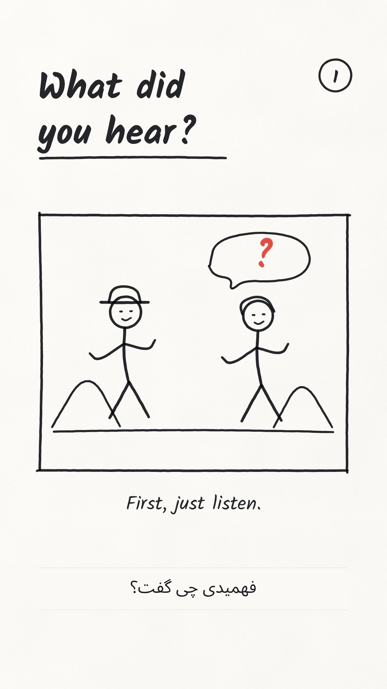
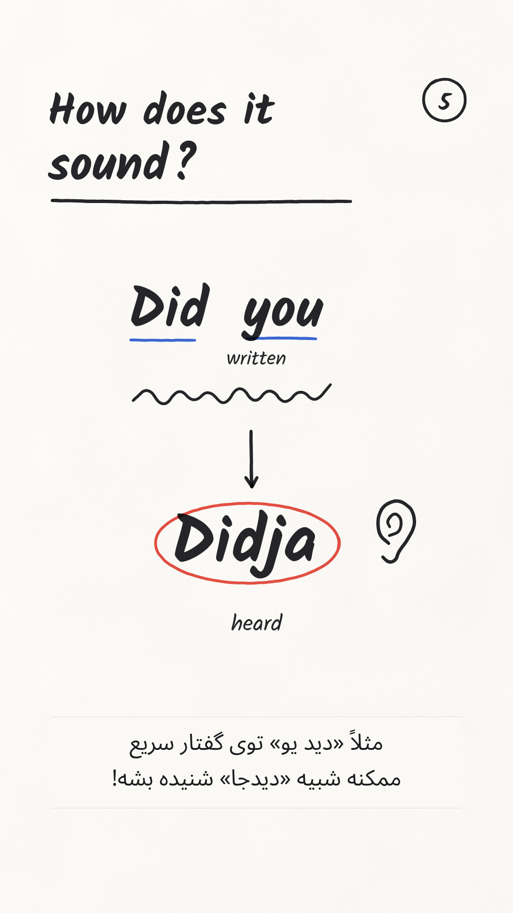
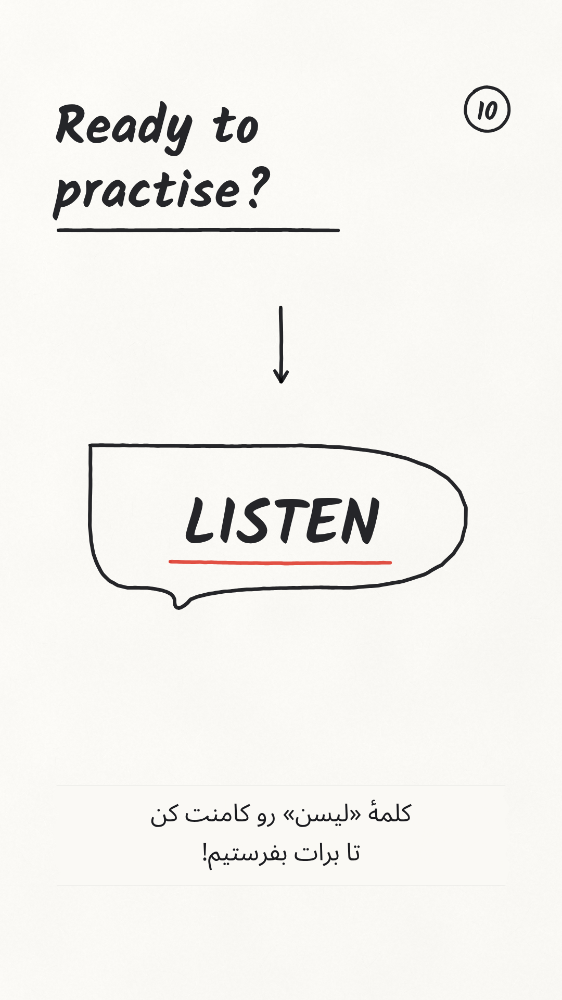

> طرح و سه فریم این سند پیش از تولید تأیید شده‌اند. نسخهٔ کامل اکنون در `video/connected-speech-marker-v1.mp4` قرار دارد. LISTEN در پایان انگلیسی است.

# طرح پیشنهادی و سه فریم نمونه — پیش از تولید

موضوع: Connected Speech برای زبان‌آموز فارسی‌زبان. استایل: **Marker on Paper**. روش انتخاب‌شده: بررسی طرح و فریم‌ها، سپس تولید کامل و مستقل.

این‌ها **فریم‌های واقعیِ جهت هنری** هستند، نه ویدیوی نهایی. نمونه‌ها با موتور خط و چگالی جوهرِ همین استایل ساخته شده‌اند. زمان‌بندیِ زیر جدول اولیه است و در تولید با ویس دقیق می‌شود؛ متن نریشن تغییر نمی‌کند.

## ۱. هوک؛ اول بشنو، بعد بخوان

دو شخصیت سادهٔ ماژیکی در یک قاب فیلمِ نقاشی‌شده قرار می‌گیرند. کادر و شخصیت‌ها در آغاز رسم می‌شوند؛ با ورود جملهٔ انگلیسیِ موجود در ویس، صدای ماژیک عقب می‌رود و پاسخ روی تصویر نوشته نمی‌شود. بعد سؤال و علامت قرمز آشکار می‌شوند. کلیپ واقعی یا شباهت دقیق بازیگران را ادعا نمی‌کنیم.

## ۲. مثال اصلی؛ نوشتار با شنیدن فرق دارد

Did you در بالا، اتصال صداها در میانه، Didja در پایین. آبی روی شکل معلوم و قرمز روی پاسخ نهایی تأکید می‌کند. مثال کامل در قاب می‌ماند تا فرصت مقایسه وجود داشته باشد. نوشته‌ها واقعاً خط‌به‌خط نوشته خواهند شد؛ Fade یا زوم روی عکس آماده نیست.

## ۳. پایان؛ یک کلمه و یک اقدام روشن

باکس کامنت با LISTEN نوشته می‌شود و آخرین خط قرمز زیر همان کلمه قرار می‌گیرد. دعوت به کامنت بدون آیکون‌ها و نوشته‌های اضافی، واضح و قابل‌دیدن باقی می‌ماند. صفحهٔ معرفی بستهٔ تمرین قبل از این صفحه خواهد بود؛ پایان به یک پوستر شلوغ تبدیل نمی‌شود.

## طرح ده صفحه‌ای، حدود ۵۸ ثانیه

| زمان پیشنهادی | تصویر و اتفاق | حرکت/اتصال | صدا |
|---|---|---|---|
| ۰ تا ۶٫۶ | قاب و شخصیت‌های ماژیکی؛ شنیدن دیالوگ بدون نمایش پاسخ؛ سپس سؤال | دنبال‌کردن خط و توقف؛ Peel به پاسخ | ماژیک در آغاز؛ هنگام دیالوگ عقب می‌رود؛ همان صدای موجود حفظ می‌شود |
| ۶٫۶ تا ۱۱٫۸ | نوشتن Darling, what are you doing? و آشکارشدن معنی | قاب ثابت، نزدیک‌شدن نرم به گروه واژه‌ها؛ Push-through | نوشتن کوتاه و همگام، کاغذ و هوای بسیار کم |
| ۱۱٫۸ تا ۱۷ | مقایسهٔ زیرنویس روشن/خاموش و گم‌شدن شنونده با وجود واژه‌های آشنا | تغییر کوچک در یک نقاشی ساده؛ Peel | تماس‌های کوتاه ماژیک، بدون افکت رابط دیجیتالِ نامرتبط |
| ۱۷ تا ۲۶٫۲ | معرفی Connected Speech؛ اتصال، کوتاه‌شدن و تغییر صداها، هرکدام یک اتفاق ساده | دنبال‌کردن خط، سپس نمای کامل؛ Push-through | ماژیک مرتبط با همان خط؛ تلفظ گوینده واضح |
| ۲۶٫۲ تا ۳۳ | Did you → Didja، مقایسهٔ نوشتار و شنیدن؛ آخرین تأکید قرمز | نزدیک‌شدن ملایم؛ مقایسه حداقل ۲٫۵ ثانیه کامل دیده شود | هنگام تلفظ مثال، افکت پایین؛ پس از آن دورگیری کوتاه |
| ۳۳ تا ۳۸ | انتخاب یک جملهٔ کوتاه و شنیدن بدون زیرنویس | قاب ثابت و رسم هدفون/نشانهٔ OFF؛ Peel | ماژیک و کاغذ، نه صدای تایپ |
| ۳۸ تا ۴۲ | روشن‌کردن زیرنویس و پیدا کردن بخش نشنیده | ورود واژه و تأکید روی همان بخش؛ Push-through | خط کوتاهِ هماهنگ با تأکید |
| ۴۲ تا ۴۹ | دوباره شنیدن بدون زیرنویس و تکرار با همان ریتم | رسم علامت‌های ریتم، نمای کامل چرخهٔ تمرین؛ Peel | تیک‌های نرم ماژیکی، با حفظ وضوح گفتار |
| ۴۹ تا ۵۴ | بستهٔ پنج مکالمه: صوت، متن و تمرین Listening | سه آیکون ساده به ترتیب رسم می‌شوند؛ Peel | ماژیک و ورق؛ بدون موسیقی |
| ۵۴ تا حدود ۵۸ | باکس کامنت، LISTEN و خط قرمز نهایی | قاب ثابت؛ پایان روی همان صفحه | صدای نوشتن متناسب با ماژیک؛ توقف افکت پس از پایان خط |

برای زمان خواندنِ پایان، حدود ۰٫۸ ثانیه نگه‌داشتن تصویر بعد از پایان ویس پیشنهاد شده است؛ هیچ جمله‌ای حذف یا کشیده نمی‌شود. تغییر بصری هر ۳ تا ۴ ثانیه می‌تواند یک خط یا تأکید کوچک باشد، نه کات نمایشی.

## چیزهایی که عمداً از فیلم قبلی منتقل نمی‌شوند

رنگ‌های گواش، بافت نقاشی روغنی، پس‌زمینهٔ طلایی، تیترهای روی تصاویر، Whooshهای متنوع، افکت گچ و حرکت‌های سه‌بعدی وارد این پروژه نمی‌شوند. اینجا کاغذ روشن، خط ماژیک، دو رنگ معنایی و حرکت‌های بومی خود استایل داریم.

## مرحلهٔ فعلی

تحلیل منابع، طرح و فریم‌های نمونه آمادهٔ بررسی‌اند. طبق انتخاب کاربر، **تولید کامل بعد از تأیید همین جهت تصویری و طرح** شروع می‌شود. هنوز MP4 یا میکس نهایی تولید نشده است.
